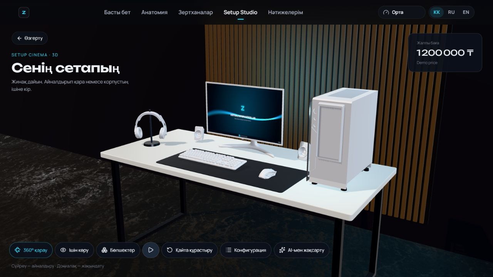
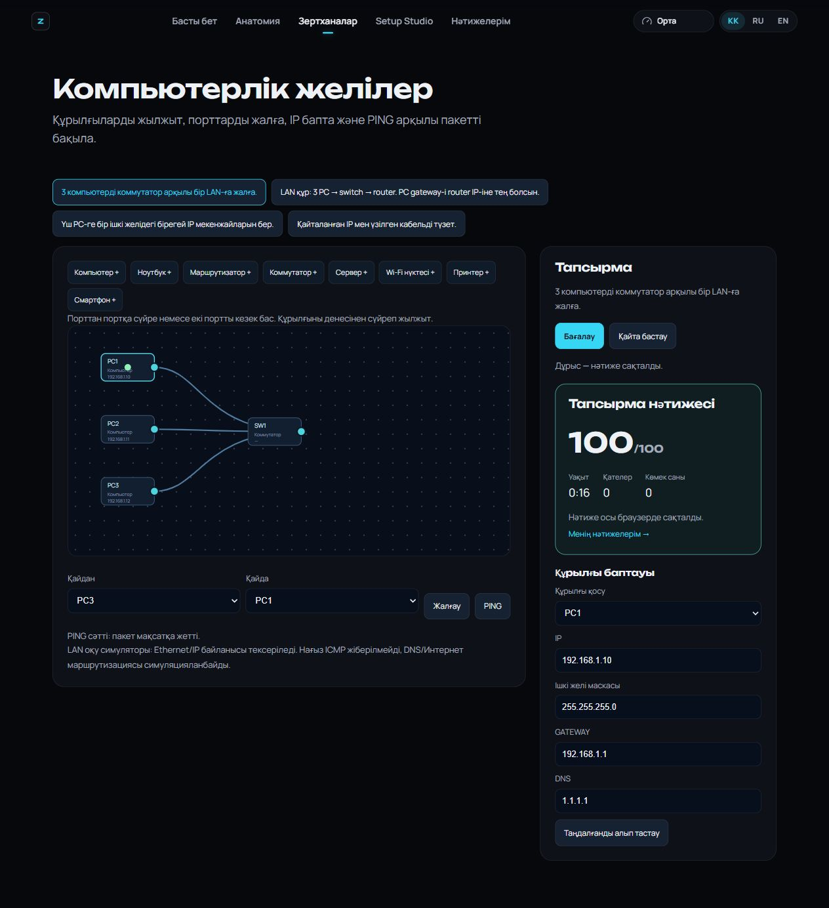
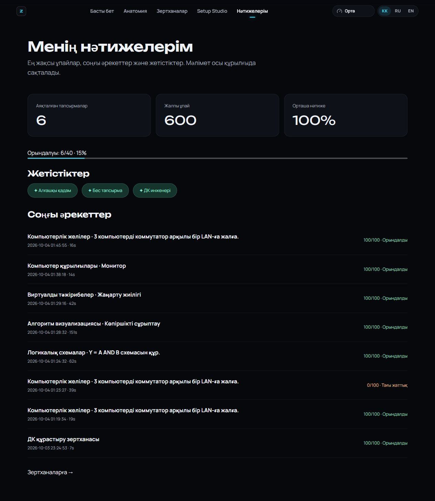

# Virtual Informatics Lab 3D

**Оқушыларға арналған виртуалды информатика зертханасы** — шынайы 3D компьютер, Setup Studio және
интерактивті информатика зертханалары бар веб-платформа.

> Ағымдағы күй: реалистік hero, анатомия, Setup Studio, құрастыру киносы, бюджет көмекшісі, PC Assembly, желі, бес алгоритм, логикалық схемалар, сегіз тәжірибе, 40 тапсырма және сақталатын прогресс жұмыс істейді. Қалған визуал/оптимизация жұмыстары — `ROADMAP.md`, жалғастыру нүктесі — `PROJECT_STATE.md`.

## Іске қосу

Node.js 22.15+ қажет (қазіргі Vite және native TypeScript тесттері үшін).

```bash
npm install
npm run dev        # http://localhost:5173
```

Windows: `start.bat` (қажет болса `npm install` жасайды да, dev серверді ашады).

| Команда | Не істейді |
|---|---|
| `npm run dev` | Vite dev сервер |
| `npm run build` | `tsc -b` + production build → `dist/` |
| `npm run preview` | build-ті жергілікті көру |
| `npm run typecheck` | TypeScript тексеру |
| `npm run lint` | ESLint |
| `npm run test:assembly` | Құрастыру реті, таңдалмаған құрылғылар, replay |
| `npm run test:assistant` | kk/ru/en сұраулар, бюджеттер, үйлесімділік, 300 Гц + Logitech |
| `npm run test:ai` | AI көмекші: талдау, бюджет/мақсат бойынша үйлесімді жинақ, fallback |
| `npm run ai:server` | LLM backend (кілт `.env`-те, міндетті емес) |
| `npm run test:pc-lab` | Орнату реттілігі, қайталанған бөлшектер, ұпай және сақтау валидациясы |
| `npm run test:learning` | Алгоритмдер, схема графы, LAN/IP және тәжірибелердің бағалауы |
| `npm test` | Барлық 22 автоматты тест |
| `npm run assets:optimize` | Шикі лицензияланған GLB → Meshopt + WebP 1K |
| `npm run assets:validate` | 16 модельдің геометриясы, декодталуы, текстуралары |

## Қарау
- `/` — жеті кезеңдік 3D scroll сапары.
- `/explorer` — компьютер анатомиясы және мини-тесттер.
- `/studio` — 65 өнім, бюджет, түс, үйлесімділік; «Сетап көмекшісі» арқылы табиғи тілдегі сұрау.
- `/studio/summary` — таңдалған жинақтың бос үстелден құрастырылуы, толық орбита, ішкі көрініс, exploded және баға.
- `/credits` — 3D модель авторлары мен лицензиялары.
- `/labs/assembly` — 3D бөлшекті сүйреп орнату, үйлесімділік, іске қосу және бағалау.
- `/labs/network` — LAN құрылысы, IP/маска/gateway, кабельдер және PING.
- `/labs/algorithms` — бес іздеу/сұрыптау алгоритмі, қадамдар мен айнымалылар.
- `/labs/logic` — алты вентиль, сигналдар, ақиқат кестесі және схеманы бағалау.
- `/labs/experiments` — CPU температурасы, RAM, SSD, кідіріс, екілік дерек, RGB, пиксельдер және Гц.
- `/assignments` — 40 тапсырма, тікелей модуль сілтемелері және ең жақсы нәтижелер.
- `/progress` — ұпайлар, әрекеттер тарихы, жетістіктер және орындалу пайызы (осы браузерде).

Құрастыруда 24-ке дейін қадам бар; тек таңдалған құрылғылар көрсетіледі. Бағалар demo, санат модельдері бірнеше нақты өнімге ортақ. Орындық, AIO кулер, бөлме және үстел параметрлік геометрия.

## Скриншоттар
`docs/screenshots/` — браузерде тексерілген құрастыру мен ішкі көрініс.





## Құрылым
Толығырақ: `ARCHITECTURE.md`.

- `src/components/3d` — SceneCanvas, сапа контроллері, жарық, камера, модель жүктегіш
- `src/locales` — `kk.json` (негізгі), `ru.json`, `en.json`
- `src/data/camera/cameraStates.ts` — аталған камера кадрлары
- `public/assets/{models,textures,hdr,audio}` — ассеттер (лицензиялары `ASSET_MANIFEST.md`-де)
- `legacy/` — ескі прототип (анықтама үшін; `python -m http.server 8077 --directory legacy`)

## Аударма қосу
Кілтті алдымен `src/locales/kk.json`-ға қосыңыз (TS кілттерді осыдан алады), содан кейін `ru.json` мен `en.json`-ға. Компонентте: `const t = useT(); t('home.title')`.
Оқу беттерінің мәтіндері `src/hooks/useEducationText.ts`, PC Lab/нәтиже мәтіндері `useLabText.ts` ішінде kk/ru/en ретінде сақталған; олар модульмен бірге жүктеледі.

## Оқу тапсырмасын қосу
Таза есептеу/тексеру логикасын `src/lib/labs/` ішінде қосып, тиісті модуль UI-ына жалғаңыз. Тапсырманы `src/data/labs/exercises.ts` тізіміне тұрақты ID және route арқылы тіркеңіз. `assessment.ts` бағалауы мен `progressStore.record` арқылы нәтиже сақталсын; тізім мен прогресс осы реестрді қолданады. Негізгі оқу логикасын `scripts/learning.test.mjs` арқылы тексеріңіз.

Желі — LAN оқу моделі; нақты ICMP/DNS/Интернет маршрутизациясын орындамайды. Тәжірибе мәндері — түсіндірілген оқу формулалары, нақты компьютер өлшемдері емес. Legacy прогресс импорты, әр SKU-ға бөлек GLB, KTX2/LOD және Firefox/Safari/нақты touch QA әлі ашық.

## Графика сапасы
Low / Medium / High / Ultra + Авто (`src/lib/quality`). Авто режим GPU мен құрылғыны анықтап, FPS төмендесе сапаны өзі түсіреді.

## AI конфигурациясы (AI Көмекші)
Көмекші екі қабатты (логика — `src/services/ai/`, UI-дан бөлек):

1. **Жергілікті ұсыныс жүйесі (негізгі, API-сіз).** Қазақша/орысша/ағылшынша мәтіннен бюджетті, бір немесе бірнеше мақсатты, стильді (ақ/қара/RGB/RGB-сіз), брендтерді (Logitech, ASUS, AMD, NVIDIA…), монитор жиілігі мен ажыратымдылығын, RAM/SSD көлемін, сымсыз құрылғыны, «толық сетап» пен «...сыз/без...» талаптарын шығарады. Тек каталогтағы өнім ID-ларын таңдайды, үйлесімділікті тексереді, бюджетке барынша жақындайды және әр негізгі таңдауды түсіндіреді. Каталогта жоқ талап ашық айтылады.
2. **LLM сервері (міндетті емес).** `server/ai-server.ts` — API кілтін тек сервер оқиды. LLM сұрауды құрылымға айналдырады және тек каталог ID-ларын ұсынады; жауап серверде де, браузерде де тексеріледі, соңғы жинақты жергілікті детерминистік жүйе құрады.

Қосу:

```bash
cp .env.example .env      # Windows: copy .env.example .env
# .env ішінде БІР кілтті толтыр: ANTHROPIC_API_KEY=... немесе OPENAI_API_KEY=...
npm run ai:server         # http://localhost:8787 (health: /api/ai/health)
npm run dev               # Vite /api/* сұрауларын серверге proxy етеді
```

- Кілт ешқашан `VITE_` префиксімен жазылмайды (ол браузер кодына түседі). `.env` git-ке кірмейді.
- Кілт жоқ, сервер өшік, 9 с ішінде жауап бермесе немесе жауабы тексерістен өтпесе — көмекші автоматты түрде жергілікті жүйеге ауысады (60 с бойы серверді қайта күтпейді).
- `VITE_AI_SERVER=off` — серверге мүлде жүгінбейтін таза жергілікті нұсқа.
- Production: `npm run build` + `npm run ai:server`; reverse proxy `/api/ai/*` → `http://localhost:8787`.
- Модель: `ANTHROPIC_MODEL` / `OPENAI_MODEL` айнымалылары.

Тест: `npm run test:ai` (сұрау талдау, 6 мақсат × 5 бюджет × 2 стиль үйлесімділігі және бюджетке жақындығы, басымдықтар, түсіндірмелер, LLM жауабын тазалау, серверсіз/қате жауап кезіндегі fallback, жақсарту режимі). Барлығы: `npm test`.

## Каталогты кеңейту
`src/data/hardware/catalog.ts` ішіне бірегей ID, ресми сипаттама сілтемесі/күні, үйлесімділік өрістері, модель жолы және demo/store бағасы бар өнім қосылады. Жаңа бренд талғамы керек болса, `src/lib/studio/assistant.ts` парсеріне қосылады. Сценаның орнын `layout.ts`, модель өлшемін `modelSize` анықтайды. Нақты SKU геометриясы жоқ болса, оны ортақ модель ретінде көрсету керек.

## Анимация
`scenes/SetupStudio/assembly/steps.ts` таңдалған жинаққа қарай қадамдарды сүзеді. Бір GSAP timeline `assemblyRig`-ті өзгертеді; `SetupItems`, `PCPart`, камера және жарық оны `useFrame` арқылы оқиды. Replay күйді бос үстелге қайтарады, Skip соңғы қалыпқа өткізеді. Жүйелік reduced-motion қысқа нұсқаны қосады.
